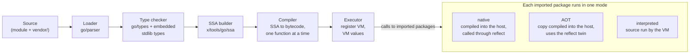

# Yaegi v2

Yaegi is Another Elegant Go Interpreter. It runs Go programs and plugins
from source, inside a Go program or from the command line, on top of the Go
runtime.

Yaegi v2 is a new engine, written from scratch. It keeps the goal of
Yaegi v0 (run [Traefik](https://github.com/traefik/traefik) plugins and Go
scripts without a compiler), but works in another way: instead of
reimplementing the Go language, it reuses the official Go tools to parse
and type check the code, and only adds an executor. The module is
`github.com/traefik/yaegi/v2`. Yaegi v0 (module `github.com/traefik/yaegi`,
releases v0.x) stays on branch `master`.

**Status: experimental.** The API is not stable yet, and Traefik does not
use yaegi v2 yet. Much of the code was written with AI assistance and is
still under review. The open work is in [TODO.md](TODO.md).

- [Why a v2](#why-a-v2)
- [Install](#install)
- [Quick start](#quick-start)
- [How it works](#how-it-works)
- [Execution modes](#execution-modes)
- [Restriction levels](#restriction-levels)
- [Security: not a sandbox](#security-not-a-sandbox)
- [Coming from yaegi v0](#coming-from-yaegi-v0)
- [Supported Go releases](#supported-go-releases)
- [Documentation](#documentation)
- [Contributing](#contributing)
- [License](#license)

## Why a v2

Yaegi v0 has its own type checker and its own implementation of the
semantics of Go. This has three costs:

- Each new Go feature (generics, iterators, the Go 1.22 loop variable,
  `min`/`max`/`clear`) must be written again by hand.
- A library that uses `reflect` on a type of the interpreted program does
  not see that type as it is. Native `encoding/json`, `fmt`,
  `text/template` or `log/slog` do not see the methods of a type that only
  exists in the interpreter (`MarshalJSON`, `String`, `LogValue`...). The
  result is often wrong, with no error.
- Libraries that use `reflect` or `unsafe` in less common ways break in
  ways that are hard to predict.

Yaegi v2 changes the foundation:

- **The Go tools do the language.** Parsing, type checking, generics and
  the meaning of the code come from `go/parser`, `go/types` and
  `golang.org/x/tools/go/ssa`. Error messages are the ones of the Go
  compiler. A new Go release is mostly new generated data, not new
  interpreter code.
- **A bytecode VM runs the code.** The SSA form of each function is
  compiled to a register bytecode and run by a loop.
- **Reflection sees interpreted types.** Yaegi v2 has a second
  implementation of `reflect` that understands interpreted values (the
  "reflect twin"), and copies of reflect-based libraries rewritten to use it
  (the "AOT copies"). With them, `json.Marshal` of a plugin value calls the
  plugin's `MarshalJSON`, as in Go.

For example, this middleware gives `{"status":{}}` with yaegi v0 and
`{"status":"status-200"}` with yaegi v2, as compiled Go does:

```go
type Status struct{ Code int }

func (s Status) MarshalJSON() ([]byte, error) {
	return json.Marshal(fmt.Sprintf("status-%d", s.Code))
}

func (h *handler) ServeHTTP(rw http.ResponseWriter, _ *http.Request) {
	_ = json.NewEncoder(rw).Encode(map[string]any{"status": Status{Code: 200}})
}
```

## Install

Command line:

```bash
go install github.com/traefik/yaegi/v2/cmd/yaegi@latest
```

Library:

```go
import "github.com/traefik/yaegi/v2/vm"
```

Yaegi v2 needs no Go toolchain at run time: the types of the standard
library are embedded in the binary (about 0.9 MB compressed per platform).

## Quick start

Run a program, like `go run`:

```bash
yaegi hello.go
yaegi ./cmd/tool arg1 arg2      # a directory or an import path of a main package
yaegi -aot prog.go              # AOT mode (see below)
yaegi -restricted plugin.go     # the restrictions of Traefik plugins
```

Evaluate Go source, or start a REPL:

```bash
yaegi -e 'import "strings"; strings.ToUpper("yaegi")'
yaegi -i
```

`yaegi -h` lists the flags. Exit codes: 0 success, 2 unrecovered panic, 3
construct not supported by the VM, 4 load or type error.

Load a plugin from a Go program. A plugin is a Go package loaded from its
source; the host calls its exported functions by name, and the methods of
the values they return:

```go
import (
	"github.com/traefik/yaegi/v2/host"
	"github.com/traefik/yaegi/v2/vm"
)

opts := host.Options()  // safe defaults for code you do not trust: AOT mode, limits, empty environment
opts.Dir = pluginDir    // the plugin module (go.mod, vendor/)
opts.Root = rootDir     // no go.mod is read above it
opts.Stdout, opts.Stderr = stdoutLogger, stderrLogger

p, err := host.Load(opts, "github.com/user/myplugin")

// A Traefik middleware: CreateConfig() *Config, then New(ctx, next, *Config, name).
res, err := p.Call(ctx, "CreateConfig")
cfg := res[0] // a *vm.Object: the interpreted *Config
err = cfg.Decode(func(ptr any) error { return decode(ptr, data) })
res, err = p.Call(ctx, "New", ctx, next, cfg, "my-plugin")
v, err := res[0].Interface()
h := v.(http.Handler) // each ServeHTTP is a call into the plugin, with its own budget

// Later, when the plugin is not used any more (for example after a reload):
err = p.Close()
```

An argument of `Plugin.Call` and `Object.Call` is an `*vm.Object` of the
same plugin, passed as is, or a native value converted to the type of the
parameter. `Object.Interface` converts a result to a native value,
`Object.Decode` lets a native decoder (mapstructure, encoding/json) fill a
pointer, and `Object.SetFields` sets fields of a pointed struct.

`vm.Load` returns a `*vm.LoadError` for a load or type error, and a
`*vm.PreflightError` (with the file and line of each problem) for code the
VM cannot run: the load-time check compiles every function the plugin can
reach, so such code fails the load, not a request. `Plugin.Notes` holds
messages about a load that worked, for the host to log.

`host` is the entry point for code you do not trust: `host.Options()`
returns safe options in one place, and `host.Load` refuses unsafe ones
(VM mode, no limits, the whole host environment, `Unrestricted`...).
`vm.Load` is the permissive API (the CLI, tests). [docs/RELOAD.md](docs/RELOAD.md)
explains how a host reloads plugins.

`vm.Session` runs Go source one input at a time, as the REPL does:

```go
s, err := vm.NewSession(opts)
res, err := s.Eval(ctx, `x := 40; x + 2`) // res: the values of a last expression, as *vm.Object
```

## How it works



Code goes through five steps. Each step is a package or a file of `vm/`;
[docs/ARCHITECTURE.md](docs/ARCHITECTURE.md) has the details.

1. **Load** (`vm/srcload.go`). The loader reads the module and its
   `vendor/` directory from disk. It selects the files of the platform with
   the rules of `go build` (build constraints, no cgo). It does not run the
   `go` command.
2. **Type check** (`go/types`). The code is checked against the types of
   the standard library, which are embedded in the binary (`stdtypes/`, the
   export data of the gc compiler).
3. **SSA** (`x/tools/go/ssa`). The SSA form of the code is built. Generic
   functions are instantiated there, so the VM never sees type parameters.
4. **Compile** (`vm/compile.go`). Each function is compiled to a register
   bytecode (about 110 opcodes) the first time it is called. When a plugin
   loads, a load-time check ("preflight") compiles every function the
   plugin can reach.
5. **Execute** (`vm/exec.go`). A loop runs the bytecode. Calls between
   interpreted functions push a frame on an explicit stack (no Go
   recursion). Goroutines are Go goroutines, channels are Go channels.

### Values

Every interpreted value has the same shape: `Value{N int64; R any}`
(`vm/value.go`). Numbers and booleans live in `N`; strings, slices,
structs, pointers, maps, interfaces and closures live in `R`. Interpreted
types are `go/types` types: they exist only inside the VM. This is the key
point of the design, and the source of its main difficulty: native Go code
cannot see these values as they are.

### The native boundary

When interpreted code calls a native function (`strings.ToLower`,
`http.Error`), the VM converts the arguments to real Go values, calls the
function, and converts the results back (`vm/native.go`). Common signatures
have generated direct calls without `reflect`. The table of native
functions, types and variables of the standard library is generated for
the Go release of the host (`stdsyms/`).

This works well for plain data. It breaks on `reflect`: Go cannot create a
named type or a method at run time, so when `encoding/json` receives a
converted value, it sees a struct without the program's `MarshalJSON`. This
is "the reflect wall", and the reason for the reflect twin and the AOT
copies.

### The reflect twin and AOT copies

- **The reflect twin** (`vm/twin_*.go`, facade package `vreflect/`) is a
  second implementation of the whole `reflect` API that works on VM values
  and on native values. Through it, code sees the real interpreted types,
  with their names and methods.
- **`cmd/aotgen`** copies a library that uses `reflect` (for example
  `encoding/json`), replaces its `import "reflect"` with the twin, and
  generates the glue. The copy is compiled into the host binary like normal
  Go code (`aot/`). It is an **AOT copy** (ahead of time: compiled before
  the plugin is known).
- An AOT copy runs at the speed of compiled Go, but it reads and writes
  interpreted values through the twin. 24 libraries have AOT copies today:
  from the standard library json, xml, gob, binary, asn1, fmt, errors,
  sort, text/template, html/template, flag, net/rpc, log/slog,
  database/sql; and yaml.v3, sigs.k8s.io/yaml, goccy/go-yaml,
  BurntSushi/toml, go-toml/v2, mapstructure, go-viper/mapstructure,
  validator, spf13/cast, go-cmp. See [docs/AOTGEN.md](docs/AOTGEN.md).
- An AOT copy is only used when it matches the version the plugin vendors
  (same module version and same source hash); otherwise the plugin's own
  version is interpreted.

## Execution modes

### Package modes

Each import path runs in one of three modes (`vm.Mode`):

| Mode | What runs | Speed | Sees interpreted types through reflect? | Example |
|---|---|---|---|---|
| **native** | the real compiled package of the host | fast (compiled Go, plus the cost of converting values) | no | `strings`, `net/http`, `regexp` |
| **AOT** | a copy of the package, compiled into the host, that uses the reflect twin | fast (median 4.9× compiled Go per call) | yes | `encoding/json`, `fmt`, yaml, validator |
| **interpreted** | the source of the package, compiled to bytecode and run by the VM | slower | yes | the plugin, its vendored libraries |

Native and AOT code must be compiled into the host binary, so the list of
these packages is fixed when the host is built. The interpreted mode
accepts any source: this is why the plugin itself is always interpreted.

### VM mode and AOT mode

**VM mode** (the default, `Options.AOT` false) is the plain interpreter:
the program and its non-standard imports are interpreted, and the standard
library is native. When the host imports the AOT copies
(`github.com/traefik/yaegi/v2/aot/all`), VM mode still sends the calls of
`fmt`, `json` and `xml` with interpreted types to the copies. When a call
would silently lose a method and cannot go to a copy, the load-time check
refuses the program, or the call returns an error: the result is never
silently wrong.

**AOT mode** (`Options.AOT = true`, `yaegi -aot`; the host must import
`github.com/traefik/yaegi/v2/aot/all`) is VM mode plus the AOT copies:
every package that has a matching copy runs in AOT mode. `json.Marshal`,
`fmt.Sprintf("%v")`, templates, `slog` and validators then see the
program's types and methods, as in Go. This is the mode for Traefik
plugins. It costs about 9 MB of binary for the copies, and the copies follow
the Go patch releases (see [Supported Go releases](#supported-go-releases)).

`Options.Modes` (or `yaegi -mode path=native|aot|interp,...`) forces the
mode of single import paths.

## Restriction levels

Independently of the execution mode, code runs with one of these levels of
access to the host process:

| Level | Options | What the code gets |
|---|---|---|
| **Restricted** (default of `vm.Load`) | none | the rules of Traefik plugins: no `os/exec`, `plugin`, `net/http/cgi` or internal packages; `unsafe` and `syscall` only with `UseUnsafe` (and of `syscall`, a read-only subset); `os.Exit` and `log.Fatal` panic instead of ending the host; its own copy of the environment and of the process-wide registries of the standard library; refused functions that act on the process |
| **Unrestricted** | `Unrestricted` | no load-time checks and the real environment, but still the restricted standard library |
| **Real process** | `Unrestricted` + `RealProcess` | the standard library as in Go: `os.Exit` ends the host, `os/exec` and `syscall` work. Only for trusted code |

`Exec: vm.ExecMock` lets a plugin import `os/exec` without running
anything. The `yaegi` command runs programs at the real process level by
default, as `go run` does; `-restrictedstd` and `-restricted` select the
other levels.

## Security: not a sandbox

Yaegi v2 runs the code inside the host process, in the same memory. It is
a correctness improvement over yaegi v0, not an isolation layer: a plugin
written to harm its host can do it. Untrusted code needs a separate
process; for Traefik, that is its Wasm plugins.

What yaegi v2 offers is guard rails against clumsy plugins and simple
mistakes:

- the import and function refusals of the restriction levels;
- an execution budget per call (`Budget`), a rate for background
  goroutines (`BackgroundRate`), a goroutine cap (`MaxGoroutines`), an
  approximate memory quota (`MaxMemory`), a load timeout and source size
  limits;
- `os.Exit`, `log.Fatal` and panics in goroutines of the plugin do not stop
  the host (`GoPanic` receives them), and `PanicOnFatal` turns some fatal
  runtime errors into panics of the plugin;
- the plugin has its own environment, standard streams and registries
  (`http.DefaultServeMux`, sql drivers...), and may not assign host
  variables;
- the loader refuses code from outside the plugin module.

`Options.Sandbox` adds capability checks (environment variables, paths
and hosts) for a part of the `os` and `net` functions, as a help against
accidents. [docs/SANDBOX.md](docs/SANDBOX.md) describes the guard rails and
their limits.

## Coming from yaegi v0

Yaegi v2 has no `interp.New`, `Eval` of a whole program or `Use`. A plugin
is loaded with `vm.Load` (or `host.Load`), and its functions are called by
name:

| yaegi v0 | yaegi v2 |
|---|---|
| `interp.New(interp.Options{GoPath: goPath})`, then `Eval("import \"" + importPath + "\"")` | `vm.Load(vm.Options{Dir: moduleDir, Root: goPath + "/src"}, importPath)`; add `GoPath: goPath` for local plugins without `go.mod` |
| `Eval(pkg + ".F")`, then `reflect.Value.Call` | `p.Call(ctx, "F", args...)` |
| a method of a result, through a wrapper package | `o.Call(ctx, "Method", args...)` |
| `mapstructure` on `v.Interface()` of a pointer | `o.Decode(func(ptr any) error { ... })` |
| `i.Eval(src)` in a REPL | `vm.NewSession(opts)`, then `s.Eval(ctx, src)`; `yaegi -e`, `yaegi -i` |
| `unsafe.Symbols` and `syscall.Symbols` | `Options.UseUnsafe` |
| `Env`, `Stdout`, `Stderr` | `Options.Env`, `Options.Stdout`, `Options.Stderr` |

By default yaegi v2 accepts a program only when `go build` would build it,
with the same files. Yaegi v0 is more lenient, so a plugin that was only
ever run with yaegi v0 may not be valid Go. These options, all off by
default, accept what yaegi v0 accepts:

| Option | Accepts |
|---|---|
| `IgnoreSoftErrors` | variables, imports and labels declared and not used |
| `IgnoreUnusedExprs` | an expression statement whose value is not used |
| `IgnoreTestFiles` | `_test.go` files in another package |
| `IgnoreDuplicateDecls` | the same declaration twice (a copy of a file) |
| `YaegiTags` | build tags from `// yaegi:tags t1 t2` lines |
| `AllowNewerGo` | a `go` directive newer than the host's Go release |
| `ImportFromArchive` | a nested module that imports packages of the module around it |
| `IgnoreInconsistentVendoring` | a `vendor/modules.txt` that does not agree with `go.mod` |

Yaegi v0 selects files with `// +build` lines only; yaegi v2 selects them
as `go build` does, and `Plugin.Notes` names each package where the two
differ.

## Supported Go releases

One yaegi v2 version supports two Go releases, N-1 and N (today Go 1.26
and Go 1.27): a host can update yaegi v2 first and move to the new Go
release later. A host built with a Go release outside this window fails at
build time, with a message that says what to update.

The AOT copies are copies of the sources of one Go patch release. When a
newer patch release changes a copied package (often a security fix), AOT
mode refuses to run with the old copies, unless the host chooses
`StaleAOTFallback` (VM mode instead) or `AllowStaleAOT`. Keep yaegi v2 up
to date with the Go patch release of the host. Details:
[docs/DEVELOPMENT.md](docs/DEVELOPMENT.md#go-patch-releases).

Embedded data exists for linux (amd64, arm64, 386, arm, ppc64le, s390x,
riscv64), darwin (amd64, arm64), windows (amd64, arm64, 386), freebsd
(amd64, 386) and openbsd (amd64, 386, riscv64). On other platforms,
`Options.GoList` loads with the `go` command instead.

## Documentation

| Document | Content |
|---|---|
| [docs/ARCHITECTURE.md](docs/ARCHITECTURE.md) | how the VM is built, file by file |
| [docs/AOTGEN.md](docs/AOTGEN.md) | the AOT copies of reflect libraries: generation, results, limits |
| [docs/SANDBOX.md](docs/SANDBOX.md) | the guard rails and their limits |
| [docs/UNSAFE.md](docs/UNSAFE.md) | what `unsafe` can and cannot do in this value model |
| [docs/RELOAD.md](docs/RELOAD.md) | how a host reloads plugins |
| [docs/BOUNDARY.md](docs/BOUNDARY.md) | every place where the standard library looks at the type or the methods of a value, with its test |
| [docs/RESULTS.md](docs/RESULTS.md) | measured results: correctness, Traefik plugin catalog, speed, memory |
| [docs/DEVELOPMENT.md](docs/DEVELOPMENT.md) | layout, build and test, CI, following a new Go release |
| [TODO.md](TODO.md) | open work, by priority |

## Contributing

See [docs/DEVELOPMENT.md](docs/DEVELOPMENT.md) to build and test. The
rules:

- Most tests run a program with `go` and with yaegi v2 and compare the
  outputs. A fix comes with a test that fails before it.
- Never loosen a comparison or skip a test to make it pass.
- The conformance suite must not regress (`go run ./cmd/runtests`).
- Code, comments and documentation are in simple English.

## License

Yaegi v2 is licensed under the Apache License, Version 2.0, like yaegi v0:
see [LICENSE](LICENSE).

Third-party material keeps its own license, with a copy in `LICENSES/`:

- `tests/yaegi/` comes from yaegi v0 (Apache-2.0, `tests/yaegi/LICENSE`);
- `internal/extract` is derived from the `extract` package of yaegi v0
  (Apache-2.0; the changes are listed at the top of `extract.go`);
- `aot/` holds generated copies of Go standard library packages
  (BSD-3-Clause, `LICENSES/Go-BSD-3-Clause.txt`) and of third-party
  modules, each directory with the license of its origin;
- `stdtypes/` embeds standard library type data and the sources of some
  standard library packages (BSD-3-Clause, `LICENSES/Go-BSD-3-Clause.txt`).
